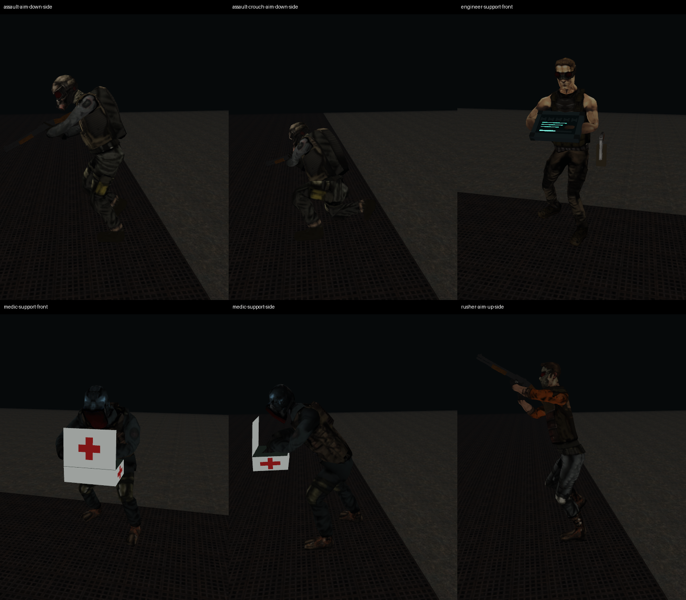

# Cleanup animation visual correction — 13 October 2026

The visible arm sheets, intersecting medical case and misplaced rifle stocks
identified in the [photo audit](cleanup-photo-audit-20261013.md) have been
corrected. The earlier visual approval remains withdrawn; this report covers
the corrective build and its observed limits.

## What changed

- Connected mesh edges now determine sleeve membership. Separate generated
  `*-skin.bin` resources preserve the original repaired OBJ, textures and RMC2
  calibration. Two isolated Sharpshooter thigh vertices incorrectly assigned
  to a hand are excluded from the derived binding.
- Arms belong wholly to the upper clip. A blended pelvis/spine band replaces
  the hard baked waist cutoff that tore during crouching. Repaired hands remain
  rigid, including their fingers.
- Torso pitch is reduced, and the head rotates about its posed neck. Spine yaw
  follows the gun sufficiently for the short arms to support it. Physics and
  rendering share `ActorBodyAim.h` and the actual RML1 body frames.
- Rifle stocks seat on the animated shoulder in both standing and kneeling
  poses. The same grip/muzzle drive rendering, shot clearance and damage.
  The support hand can use the receiver or fore-end; a bounded 4.5 cm shoulder
  reach preserves the imported arm lengths during extreme aim.
- The Medic carries the case below the posed shoulders and ahead of the posed
  torso. Its far hinge opens away from the Medic's chest, and both hands fit
  the case. The Engineer support fixture now uses standing legs.
- A moving crouched guard retains its crouched visual posture. Weapon height
  follows animated shoulders instead of the larger conservative collision hull.

The bake regenerates connected bindings automatically and publishes the Medic
only after its treatment clip is appended. Repeating the bake preserves all
13 generated assets byte-for-byte and leaves their timestamps unchanged.

## Verification

| Check | Result |
|---|---|
| Native Vulkan pose/view sweep, six roles × sixteen poses × two views | 192 passed |
| Additional Rusher aim, rifle down-aim and Medic treatment phase views | 36 passed |
| Split/layer geometry checks | 103 passed |
| Friendly AI, guard combat, actions, policy, defense and Engineer drones | All six suites passed |
| Protected source geometry/calibration/texture hashes | All 26 unchanged |
| Embedded release resources | All 228 match their source losslessly |
| Local `RawMetal.exe` | 28,511,744 bytes; below 33,554,432-byte limit |

Reviewed all six complete pose sheets, native close-ups and the phase sequences.
The renderer inspection now checks every mesh edge in addition to the selected
hand edges that missed the original failures. Numerical bounds remain a
regression check; the photographic review is separate.

Reproduce with `RawMetal.exe --cleanup-layer-inspection`. Optional
`--cleanup-layer-role=0..5`, `--cleanup-layer-sample=0..15`, and
`--cleanup-layer-phase=0..1` select cases. `--cleanup-layer-stage=1`, `2`, or `3`
isolates the donor bake, composed layers, or immutable bind mesh; ordinary
rendering uses stage `0`. Local captures and logs are under
`diagnostics/photo-audit-20261013` and
`diagnostics/animation-repair-20261013/native`.

## Limits still present

Guard roles still fails its four existing Medic detour/patient-proximity
assertions. Smoke still exits 38 at the authored-save byte-exact check. These
were rerun on this build and remain unresolved.

Crouched movement currently uses the kneeling loop; a dedicated crouch-walk
donor and full state-transition/stride synchronization review remain pending.
The staged images do not establish successful live healing or overall GoldSrc
parity.
