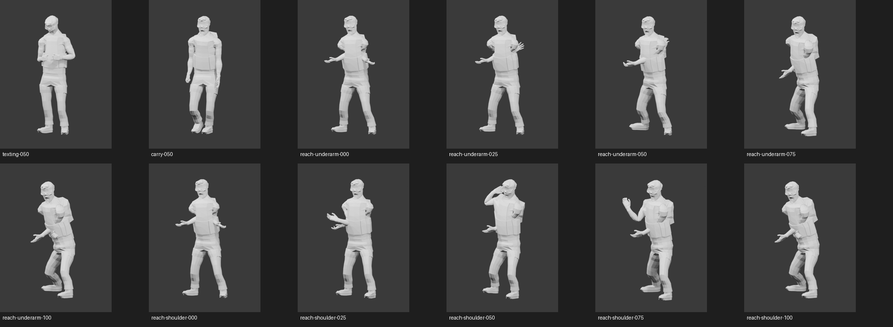

# Engineer rig, motion intake and obsolete animation cleanup

Engineer was uploaded with both original hands intact. The user placed its
body rig markers. Mixamo returned 57 bones, with no pinky chains. The repair
retains those 57 bones and every mesh vertex, adds two fitted pinky chains,
and changes 1,154 pinky/web vertex weights. Ten independent finger curl
checks passed. The repaired 65-bone FBX was reuploaded and accepted.

The original export, fixed FBX and repair report are retained in
`source-assets/cleanup-repairs`. The repair is reproducible with
`tools/RigEngineerPinkies.py`; it does not mirror or replace either hand.

## Animation collection

Six packs and 23 individual clips provide 123 FBX files: 122 animation
files and one static character. All 123 were imported and checked for 65
bones, all 30 finger joints, valid animation ranges and finite poses at
three sample times. SHA-256 hashes verify the local archive and file copies.
This structural audit is not a visual pass for every animation.

102 animated FBXs use 24 fps. The pistol pack's 20 motions and its static
character retain 30 fps despite the browser's 24 fps setting. The catalog
preserves actual source timing; the final bake must resample to 24 fps.

Original FBX skinning was rendered for texting, briefcase walking and both
generic equip gestures. These renders bypass the old anatomical retargeter.
The motions preserve their full body poses; pad/pistol props, waist aiming
and final transition timing have not been applied in these source renders.

The requested sequence is pad texting while standing, briefcase carry while
walking, then a reach-behind prop swap to the pistol. The pad must be stowed
before jumps or evasive movement, or those actions use pistol animations
when already armed. Both hands must be free for ladders. Generic axe equip
gestures need adaptation; they are not a finished pistol draw.

The source library also includes turns, pistol strafing/running/kneeling,
pistol jumps, cover, falls, landing/roll recovery, injury locomotion, death
variants, squad gestures, device work, pickup, case lid handling and ladders.
Pack overlaps are retained for source selection.

## Cleanup and runtime boundary

Cleanup removed 362 obsolete or verified duplicate files, freeing
504,139,917 bytes. Diagnostic PPMs were replaced with lossless PNGs after
exact RGB and dimension comparisons. Superseded bake backups, the old
executable backup, obsolete Assault animation downloads and verified
duplicate staging files were removed. Original source rigs, current assets,
and the original donor motions used by the existing baker were retained.

After the Engineer library passed its audit, another 30 verified copies in
Downloads were removed. Every extracted FBX hash was checked first; all
Engineer source FBXs, six archives and the original marker-placed rig remain
in the workspace.

All 125 protected files were hash-identical before and after cleanup. A
fresh asset-packer comparison verified all 228 embedded resources against
the current source assets. The executable remains 28,511,744 bytes.

This pass collects and verifies source assets as requested before slicing.
The new Engineer rig and animations are not in the game yet. The later
integration must publish matching skinning, animation and attachment data,
preserve actual finger poses, implement the prop transitions, and visually
verify them in the game. No GoldSrc parity or new gameplay test pass is
claimed here.
