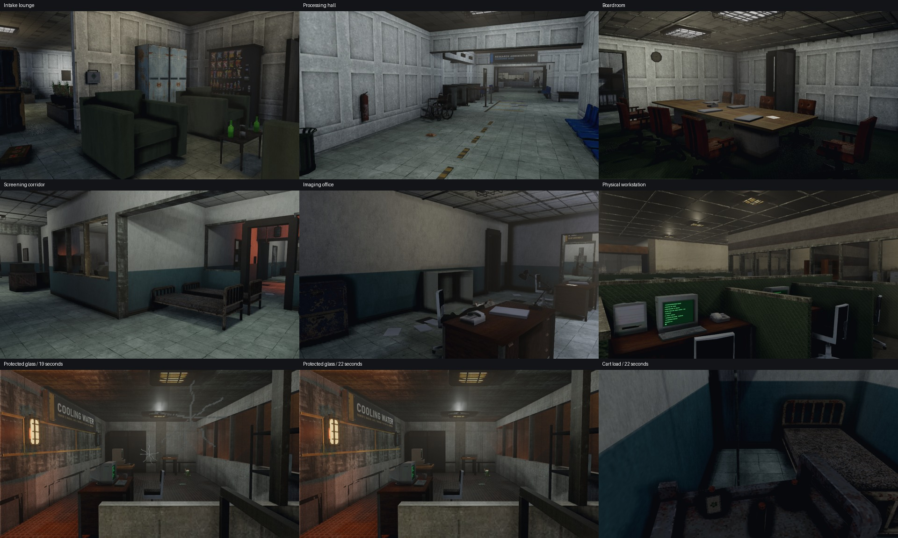

# v1.1.5 additional visual review — 2026-10-31

The checked executable is 47,415,808 bytes, SHA-256 `073fc611af0fe870b945acaaf36bc99f3007d489f19e6ee21557b91bfe5d369e`. This is the same binary as the local v1.1.5 package. No new game-code defect was confirmed by this pass, and no gameplay or asset changes were made.

## Coverage

- 123 new native Vulkan campaign captures at 960×540 across maps 0, 1, 2, 3, 15, 16, 20, 21, 34, 35, 36, 37, 42, 47, 48, 52, 53, 54, 57, 58, 61, 63, 64, 65, 67 and 68–73. Views cover arrivals, interiors and alternate ground-floor positions, using arrival power states where applicable.
- 19 additional timed Vulkan captures: two records-room actor views at frames 0/1/60/180/360, medical cart contents at 0/120/600/1320, and protective glass after verified shotgun fire at 1/120/1140/1230/1320 frames.
- 14 software-renderer physics inspection captures: desktop impact, thrown monitor, protective crack stages, glass litter and bounded fixture-screen destruction. These diagnostic scenes apply their designed impact directly; the unarmed HUD does not indicate a missed shotgun input.
- All capture commands returned exit 0. The campaign glass sequence logged five shotgun shots, each loaded 6 -> 5.

## Findings

No new confirmed clipping, floating-load, furniture-facing, missing-material or glass-compositing defect was found in the reviewed views. The previously corrected theatre, waiting rows, boardroom, medical spaces and converted workstations retain their intended presentation.

The records-room figures looked unusual from one angle; inspection of the owning scene and repeated snapshots showed the authored static leaning poses, without newly developing mesh separation. The medication load remained stable over the 22-second cart sequence. Protective glass retained visible cracks at 19 seconds, faded after 20 seconds and appeared intact at 22 seconds. The bounded monitor screen break retained its casing, and the thrown-monitor inspection showed the intended airborne trajectory.

Automatic sample points that face a wall or sit inside nearby machinery are excluded from clear-view sign-off: new_ch68_3, new_ch71_3, new_ch71_4, new_ch72_3, new_ch73_3, new_sv_3_0, new_sv_34_5, new_sv_47_0, new_sv_48_4, new_sv_53_4 and new_sv_61_4. These are camera-coverage limitations.

## Evidence and limits

Raw frames, exact camera lists, the binary fingerprint, capture exit records and the full contact-sheet indexes are retained locally under `.build/visual-review-20261031/{broad,focus}`. The representative board above is ordered left-to-right, top-to-bottom: intake lounge, processing hall, boardroom, screening corridor, imaging office glazing, legacy workstation, protective glass at 19 seconds, protective glass at 22 seconds and cart load at 22 seconds.

Desktop control reached the normal loading screen but lost the live window before the interactive pass (`foreground window did not report a process id`). A complete live campaign playthrough or headset session is not claimed. The visual conclusions here come from inspected native renderer captures; the earlier full regression, Vulkan, save and 76-map audit results remain recorded in `.build/codex-report-2.md`.

## Release

After the additional visual review, the user explicitly requested committing and publishing this copy as a GitHub release. The verified Windows executable, ZIP and checksum file are prepared for v1.1.5. This later authorization supersedes the initial local-only handoff.
